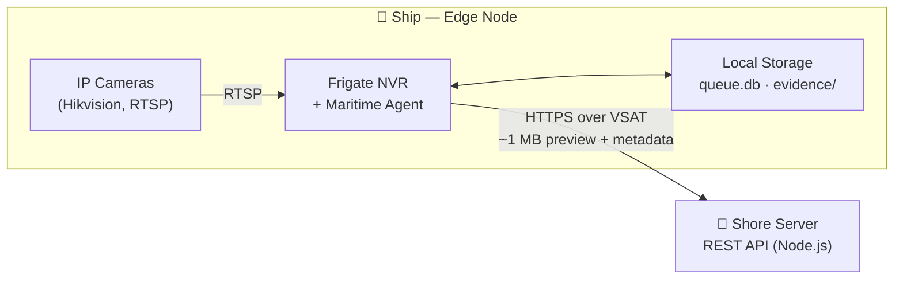
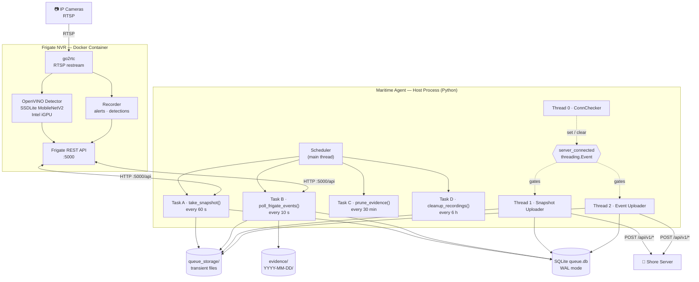
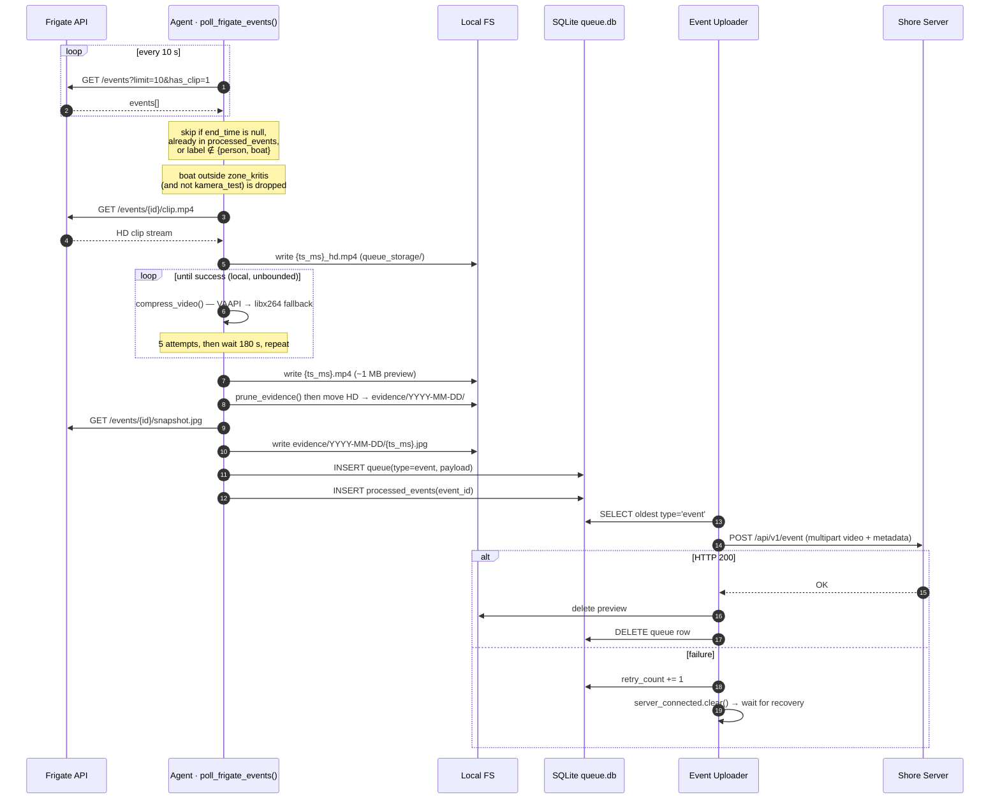
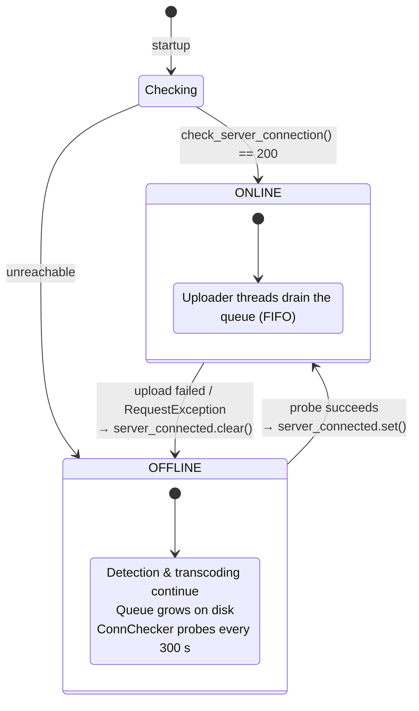

<div align="center">

# 📐 System Architecture

**Maritime Edge-NVR Alert System**

*How detection, transcoding, durable queuing, and store-and-forward delivery fit together.*

</div>

---

## Table of Contents

1. [Design Goals & Constraints](#1-design-goals--constraints)
2. [System Context](#2-system-context)
3. [Component Architecture](#3-component-architecture)
4. [Component Breakdown](#4-component-breakdown)
5. [Data Model](#5-data-model)
6. [Key Data Flows](#6-key-data-flows)
7. [Connectivity State Machine](#7-connectivity-state-machine)
8. [Storage Lifecycle](#8-storage-lifecycle)
9. [Design Decisions](#9-design-decisions)
10. [Failure Modes & Resilience](#10-failure-modes--resilience)
11. [Known Limitations & Trade-offs](#11-known-limitations--trade-offs)
12. [Deployment Topology](#12-deployment-topology)

---

## 1. Design Goals & Constraints

The system runs **onboard a vessel**, which dictates almost every architectural decision.

| Constraint | Consequence on the design |
| :--- | :--- |
| **VSAT bandwidth is scarce and expensive** | Raw HD video must never leave the ship. Only a ~1 MB preview + JSON metadata is transmitted. |
| **Connectivity is intermittent** | Every alert is persisted locally *before* transmission. Delivery is decoupled from production via a store-and-forward queue. |
| **Power can drop at any moment** | The queue database uses SQLite **WAL** mode so a hard power-cut cannot corrupt it. |
| **No operator on board** | The pipeline must be fully autonomous: retries, pruning, and cleanup are scheduled, not manual. |
| **Weak CPU, but an available iGPU** | AI inference (OpenVINO) and video transcoding (VAAPI) are both offloaded to the Intel iGPU. |
| **Storage is finite** | Evidence is capped (200 GB) and recordings expire (3 days) via automatic lifecycle jobs. |

> **North-star requirement:** *Never lose an alert.* Losing a detection is worse than delivering it late.

---

## 2. System Context

At the highest level there are three actors: the **cameras**, the **edge node** (the ship), and the **shore server**.



| Actor | Responsibility |
| :--- | :--- |
| **IP Cameras** | Provide RTSP streams (mainstream 1080p + substream 360p). |
| **Edge Node** | Detects objects, records, transcodes, stores evidence locally, and forwards alerts. |
| **Shore Server** | Receives alerts and snapshots over the REST API; source of truth for the fleet. |

---

## 3. Component Architecture

The edge node is composed of two cooperating runtime units: the **Frigate NVR container** and the **Maritime Agent** running on the host.



**Reading the diagram**

- **Frigate** owns everything camera-facing: ingesting RTSP, running inference, and recording. It exposes a REST API on port 5000.
- **The agent** never talks to cameras directly. It is a pure *consumer* of Frigate's API plus a *producer* for the shore server.
- **The `server_connected` event flag** is the single coordination primitive between the production side (scheduler) and the delivery side (uploader threads).

---

## 4. Component Breakdown

### 4.1 Frigate NVR (Docker)

| Sub-component | Configuration | Role |
| :--- | :--- | :--- |
| **go2rtc** | `go2rtc.streams` | One connection to each camera, shared by detection, recording, and live view. Auto-reconnects on stream loss. |
| **OpenVINO detector** | `detectors.ov`, device `GPU` | Runs SSDLite MobileNetV2 (300×300) on the Intel iGPU. |
| **Object filters** | `objects.filters` | `person`: area 1500–100000, score ≥ 0.6 · `boat`: area 1000–200000, score ≥ 0.4. |
| **Detect stream** | `detect` | 640×360 @ 3 FPS from the substream — keeps CPU load low. |
| **Zones** | `cameras.*.zones` | `zone_kritis` (boat) and `warning_zone` (person) with `loitering_time: 3` to reject swell-induced false positives. |
| **Recorder** | `record` | Alerts/detections retained 3 days, 5 s pre/post capture. Continuous & motion recording disabled to save disk. |
| **REST API** | port 5000 | The agent's only integration point. |

### 4.2 Maritime Agent (`agent/maritime_agent.py`)

The agent is a single Python process with **one scheduler in the main thread** and **three daemon threads**.

**Scheduled tasks (main thread)**

| Task | Interval | Function |
| :--- | :--- | :--- |
| **A** — Snapshot tracing | 60 s | `take_snapshot()` — grab `latest.jpg` per camera, enqueue as `type=snapshot`. |
| **B** — Event listener | 10 s | `poll_frigate_events()` — detect → download → transcode → enqueue. |
| **C** — Evidence pruning | 30 min | `prune_evidence()` — enforce the 200 GB → 150 GB policy. |
| **D** — Recordings cleanup | 6 h | `cleanup_recordings()` — delete recordings older than 3 days. |

**Threads**

| Thread | Loop | Blocking behaviour |
| :--- | :--- | :--- |
| **ConnChecker** | Probes the link every 5 min **while offline** | Calls `server_connected.set()` on recovery; idles when already online. |
| **Snapshot Uploader** | `server_connected.wait()` → take oldest `snapshot` → `POST /api/v1/snapshot` | Blocks on the flag when offline (zero CPU). |
| **Event Uploader** | `server_connected.wait()` → take oldest `event` → `POST /api/v1/event` | Blocks on the flag when offline. Independent of the snapshot uploader. |

**Why separate uploader threads?** A large alert video upload (up to 120 s timeout) must not stall snapshot delivery. Each queue type has its own consumer, so the two streams never contend for the same worker.

### 4.3 Configuration Loading

Configuration is environment-driven, resolved in this priority order:

```
process environment  (systemd / Docker / shell)
        │  (wins — never overwritten)
        ▼
agent/.env           (loaded via os.environ.setdefault)
        │
        ▼
hard-coded defaults  (in maritime_agent.py)
```

This means the same code runs in development (`.env` file) and in production (systemd unit or container environment) without modification. `.env` and `config/config.yml` are gitignored; only the `*.example.*` templates are tracked.

---

## 5. Data Model

The queue is a **single SQLite database** (`queue.db`) in WAL mode, capped at 10 GB (`max_page_count = 2621440` × 4 KB pages).

### Table `queue` — the store-and-forward log

| Column | Type | Meaning |
| :--- | :--- | :--- |
| `id` | INTEGER PK | Auto-increment queue position. |
| `type` | TEXT | `snapshot` or `event` — determines which uploader thread consumes it. |
| `file_path` | TEXT | Absolute path to the payload file on disk. |
| `payload` | TEXT | JSON blob of the metadata sent alongside the file. |
| `priority` | INTEGER | Reserved for prioritisation (events = 1, snapshots = 2). |
| `timestamp` | INTEGER | UNIX seconds; FIFO ordering key. |
| `retry_count` | INTEGER | Incremented on each failed upload attempt. |

### Table `processed_events` — deduplication

| Column | Type | Meaning |
| :--- | :--- | :--- |
| `event_id` | TEXT PK | Frigate event IDs already ingested, so a re-poll never double-processes an alert. |

### Event payload schema

```json
{
  "ship_code":  "KP-001",
  "camera_id":  "kamera_depan",
  "event_id":   "1717401234.567890-abcdef",
  "label":      "boat",
  "confidence": 0.8731,
  "severity":   "critical",
  "duration":   12,
  "started_at": "2026-10-02T14:31:07.000+07:00",
  "timezone":   "WIB"
}
```

> Timestamps are emitted as **ISO 8601 in WIB (UTC+7)** via `_ts_to_iso()`, independent of the host's local timezone.

### File naming convention

Every artifact is named from the event's **start time in UNIX milliseconds**:

```
1780896211014_hd.mp4   ← HD evidence (kept locally, never uploaded)
1780896211014.mp4      ← compressed ~1 MB preview (uploaded to shore)
1780896211014.jpg      ← snapshot evidence (kept locally)
```

This guarantees 100 % uniqueness with no collision risk, and the filename alone encodes the event's absolute time.

---

## 6. Key Data Flows

### 6.1 Event Alert Pipeline (the critical path)



**Key ordering guarantee:** the row is written to `processed_events` only *after* the clip has been downloaded and the queue row inserted. If the clip download fails (`HTTP 400`, not yet ready), the function `continue`s and the event is re-evaluated on the next poll — no alert is silently dropped.

### 6.2 Snapshot Tracing Pipeline

A lighter, continuous path that gives shore-side operators a near-live view:

```
every 60 s
   └─ for each camera:
        GET {FRIGATE_API}/{cam}/latest.jpg?h=1080
        write snapshot_{cam}_{ts}.jpg → queue_storage/
        INSERT queue(type=snapshot, priority=2, payload{captured_at in WIB})
   └─ Snapshot Uploader: POST /api/v1/snapshot (multipart JPEG)
        └─ on 200: delete file + row
```

Unlike events, snapshots **are** deleted from disk after a successful upload — they are transient telemetry, not evidence.

### 6.3 Store-and-Forward Principle

The two flows above share one invariant:

> **Production never touches the network; delivery never touches the cameras.**

Detection, recording, transcoding, and disk writes happen entirely offline. Only the two uploader threads perform network I/O, and they do so exclusively through the queue. This is what makes the system survive a VSAT outage of any duration.

---

## 7. Connectivity State Machine

A single `threading.Event` (`server_connected`) gates all outbound traffic.



**Design notes**

- `Event.wait()` blocks with **zero CPU cost** while offline — no busy-polling, important on a low-power edge box.
- The checker only probes while offline. Once online, failures are detected *implicitly* by the uploader threads, which clear the flag on the first error.
- Recovery latency is bounded by `CONNECTION_CHECK_INTERVAL` (default **300 s**).

---

## 8. Storage Lifecycle

Three independent retention policies keep the disk bounded.

| Store | Location | Policy | Enforced by |
| :--- | :--- | :--- | :--- |
| **Evidence** (HD video + snapshot) | `evidence/YYYY-MM-DD/` | Prune at **200 GB**, delete oldest **HD+JPG pairs** (FIFO) until **150 GB** remains; remove emptied date folders. | Task C (30 min) + pre-write check |
| **Continuous recordings** | `storage/recordings/YYYY-MM-DD/` | Delete whole date folders older than **3 days**. | Task D (6 h) |
| **Snapshot queue** | `queue_storage/` + `queue` table | If > **5000** rows, delete the 500 oldest before each upload. | Snapshot Uploader |
| **Event queue** | `queue_storage/` + `queue` table | Bounded indirectly: file deletion on success + the 10 GB DB cap. | Event Uploader + SQLite |

**Pruning is precision-based, not blunt:** `prune_evidence()` sorts every file by mtime and deletes oldest-first, but always removes the `_hd.mp4` and its matching `.jpg` together — so evidence is never left half-deleted.

---

## 9. Design Decisions

| # | Decision | Rationale | Trade-off accepted |
| :-- | :--- | :--- | :--- |
| 1 | **Compress on the edge, never send HD** | A 30 s 1080p clip is tens of MB; a ~1 MB preview is 20–30× smaller. This is the single biggest bandwidth lever. | Shore loses forensic-grade detail; HD is retained locally for retrieval. |
| 2 | **SQLite as the message broker** | Zero external dependencies, crash-safe with WAL, trivially deployable on a ship. | Single-writer semantics; not suitable for multi-node fan-out. |
| 3 | **Polling Frigate every 10 s** (not MQTT) | Simplest possible integration; no broker to run or secure. | Up to ~10 s detection latency; one extra request per interval. |
| 4 | **`threading.Event` as the connectivity gate** | One primitive coordinates all I/O; uploaders sleep at zero cost when offline. | Global flag — a failure in one uploader pauses *all* uploads (acceptable: it implies the link is down). |
| 5 | **Separate uploader threads per queue type** | A slow video upload must not delay snapshots. | Slightly more concurrency to reason about. |
| 6 | **UNIX-ms filenames** | Guarantees uniqueness across restarts and concurrent events; encodes time. | Filenames are not human-readable. |
| 7 | **Infinite local compression retry** | Guarantees a preview exists before the event is queued — so nothing HD is ever transmitted as a fallback. | Ingestion can stall if the encoder is persistently broken (see §11). |
| 8 | **Secrets via environment / `.env`** | Credentials never enter git history; identical code across dev and prod. | Operator must provision `.env` or systemd environment. |

---

## 10. Failure Modes & Resilience

| Failure | System behaviour | Data loss? |
| :--- | :--- | :--- |
| Internet / VSAT down | Detection, recording, transcoding continue; queue grows on disk; ConnChecker probes every 5 min. | **No** |
| Link recovers | Flag set; both uploaders drain the queue FIFO. | **No** |
| Upload interrupted mid-transfer | Flag → False; row stays in queue with `retry_count += 1`; retried on recovery. | **No** |
| VAAPI encoder unavailable | Same-round fallback to `libx264`. | **No** |
| Both encoders fail | 5 attempts → 180 s wait → new cycle, repeated until success. | **No** |
| Clip not ready (`HTTP 400`) | Event is **not** marked processed; re-evaluated on the next poll. | **No** |
| Snapshot file missing on disk | Queue row is deleted and skipped (self-healing). | Snapshot only |
| Sudden power loss | SQLite **WAL** mode guarantees the DB is not corrupted; uncommitted writes roll back. | **No** |
| Disk filling up | Evidence pruning (200→150 GB) + recordings cleanup + snapshot queue cap. | Oldest evidence only |
| Frigate container crash | `restart: unless-stopped` + healthcheck (`/api/version`) restart it automatically. | **No** |

---

## 11. Known Limitations & Trade-offs

Documented honestly — these are the natural consequences of the decisions in §9, and each maps to a roadmap item.

1. **Task B runs on the scheduler's main thread.** `poll_frigate_events()` performs the clip download *and* the unbounded compression retry loop inline. While it is compressing, Tasks A/C/D cannot run, so snapshot cadence can slip during a long compression stall. A future revision would move ingestion into its own worker thread and let the scheduler only enqueue.
2. **Connectivity probe is a placeholder.** `CONNECTION_CHECK_URL` defaults to `https://www.google.com`. This detects *internet* reachability, not shore-server health, and can be fooled by a captive portal. The roadmap item is to point it at `SERVER_API_URL` and validate the response body.
3. **`processed_events` grows without bound.** Deduplication rows are never pruned. Growth is slow (one row per alert) but non-zero; a periodic purge keyed on age is advisable.
4. **Event queue has no soft cap.** Snapshots are capped at 5000 rows, but events are unbounded — they are limited only by the 10 GB SQLite cap and available disk.
5. **`priority` is stored but unused.** Both uploaders select strictly by `timestamp ASC`, so an event and a snapshot of the same age are served FIFO regardless of priority.
6. **The critical zone is only configured for `kamera_test`.** In `poll_frigate_events()`, boats on any camera *other* than `kamera_test` require membership in `zone_kritis`; the forward camera's zone still needs to be defined in `config.yml`.

---

## 12. Deployment Topology

```
┌───────────────────────────────────────────────────────────────┐
│  Ship (Edge Node) — Ubuntu/Debian, i7-6700 + HD 530 iGPU      │
│                                                               │
│  ┌─────────────────────────────────────────────────────────┐  │
│  │ Docker Compose                                          │  │
│  │   frigate (ghcr.io/blakeblackshear/frigate:stable)      │  │
│  │     • /dev/dri/renderD128, /dev/dri/card0 (iGPU)        │  │
│  │     • shm_size 1 GB · tmpfs /tmp/cache 1 GB             │  │
│  │     • ports 5000 (UI) · 8554 (RTSP) · 8555 (WebRTC)     │  │
│  │     • volumes ./config → /config, ./storage → /media    │  │
│  │     • healthcheck → /api/version · mem limit 4 GB       │  │
│  └─────────────────────────────────────────────────────────┘  │
│                                                               │
│  Host process: python3 maritime_agent.py                      │
│     • reads agent/.env (or systemd environment)               │
│     • writes agent/queue.db, queue_storage/, evidence/        │
│     • needs VAAPI access for FFmpeg hardware encoding         │
│                                                               │
│  Operational scripts: monitor.sh · restart.sh · update.sh     │
└───────────────────────────────────────────────────────────────┘
                              │
                              │ VSAT / Internet (HTTPS)
                              ▼
┌───────────────────────────────────────────────────────────────┐
│  Shore Server — REST API (Node.js)                            │
│    POST /api/v1/event      ← ~1 MB preview + JSON metadata     │
│    POST /api/v1/snapshot   ← JPEG + metadata                   │
│    Auth: Authorization: Bearer <API_KEY>                      │
└───────────────────────────────────────────────────────────────┘
```

**Port summary**

| Port | Protocol | Service |
| :--- | :--- | :--- |
| 5000 | HTTP | Frigate Web UI + REST API (consumed by the agent) |
| 8554 | RTSP | go2rtc restream |
| 8555 | TCP/UDP | WebRTC low-latency live view |

---

<div align="center"><sub>See <a href="../README.md">README.md</a> for setup and configuration.</sub></div>
